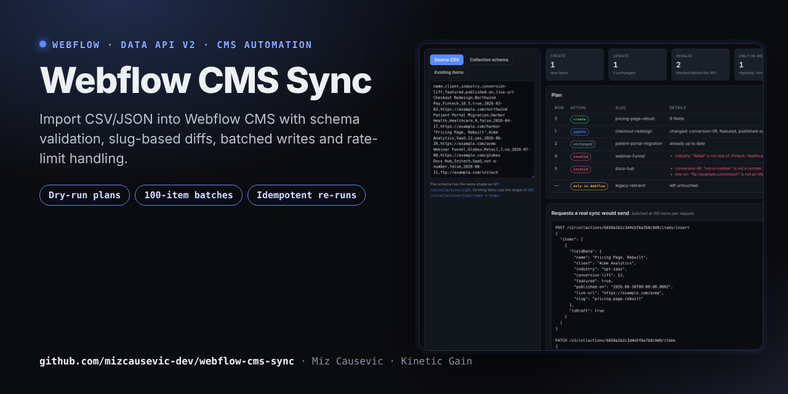
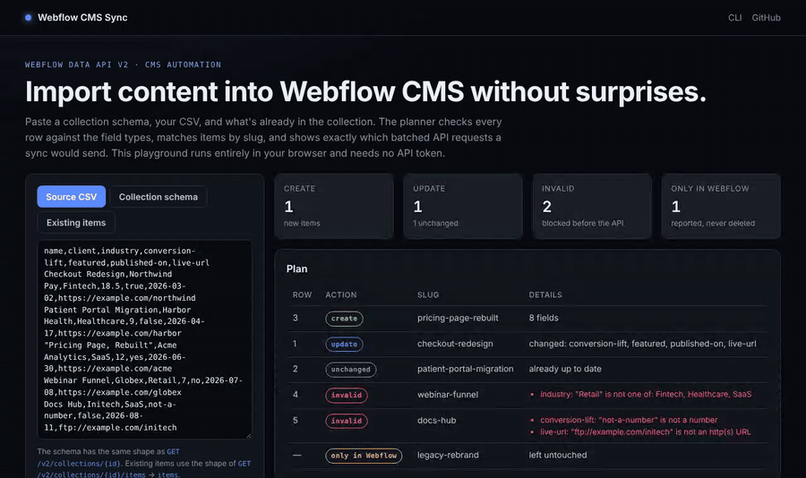

# Webflow CMS Sync

[](https://github.com/mizcausevic-dev/webflow-cms-sync/actions/workflows/ci.yml)
[](https://mizcausevic-dev.github.io/webflow-cms-sync/)


**Live playground: https://mizcausevic-dev.github.io/webflow-cms-sync/**

[](https://mizcausevic-dev.github.io/webflow-cms-sync/)

A CLI and library that sync CSV or JSON content into a Webflow CMS collection through the **Webflow Data API v2**. It checks every row against the collection's field schema, matches items by slug, writes only what changed in batches of 100, respects rate limits, and can publish at the end. It runs as a dry run by default.

## See it in action



## The problem it solves

CMS imports are where Webflow projects go wrong. The usual failures are a misspelled Option value, a date in the wrong format, a 429 halfway through 400 items, or a re-run that duplicates everything. This tool makes the import **planned, validated, idempotent and resumable**.

## Features

| | |
|---|---|
| Schema-aware validation | Coerces and checks `PlainText` (maxLength), `Number`, `Switch`, `DateTime`, `Email`, `Link`, `Color`, `Option` (by name or id), `Image`, plus required fields and unknown columns |
| Diff by slug | Splits rows into create / update (only the changed fields) / unchanged / invalid / duplicate. Items only in Webflow are reported and never deleted |
| Batched writes | `POST /items/insert` and `PATCH /items` at the documented 100-item limit, then optional `POST /items/publish` |
| Rate-limit handling | On `429` it waits for `Retry-After` (exponential backoff when absent), and slows down when `X-RateLimit-Remaining` runs low. A `5xx` is retried only for idempotent requests: a failed `POST` may already have been written, so it's reported instead of resent, and re-running is safe because items match by slug |
| Idempotent | Running the same file again produces zero writes, including fields Webflow returns in a different shape (dates without milliseconds, images as `{ fileId, url, alt }`) |
| Safe by default | Dry run unless `--apply`. The token comes only from the environment. IDs are validated before they're used in URL paths |

## Usage

```bash
export WEBFLOW_TOKEN=…   # site token with CMS read + write
node bin/webflow-cms-sync.mjs --collection 6650a1b2c3d4e5f6a7b8c9d0 --file examples/case-studies.csv
# DRY RUN: 3 create, 0 update, 0 unchanged, 2 invalid, 0 duplicate, 0 only in Webflow
#   row 4: industry: "Retail" is not one of: Fintech, Healthcare, SaaS
#   row 5: conversion-lift: "not-a-number" is not a number; live-url: "ftp://…" is not an http(s) URL

node bin/webflow-cms-sync.mjs --collection <id> --file data.csv --apply --publish
```

Exit codes: `0` success, `1` plan has invalid rows, `2` usage, auth or API error.

Use it as a library too:

```js
import { WebflowClient } from './src/client.js';
import { sync } from './src/sync.js';
const client = new WebflowClient({ token: process.env.WEBFLOW_TOKEN });
const result = await sync(client, { collectionId, records, dryRun: false, publish: true });
```

## Architecture

```
bin/webflow-cms-sync.mjs ── src/sync.js ── src/client.js   fetch, retries, pacing, typed errors
                                 │
                                 └── src/plan.js ── src/schema.js   pure: validate, coerce, diff
                                                    src/csv.js      RFC 4180 parser
index.html + src/app.js  ── the same pure modules in the browser (playground)
```

The planner is pure and shared by the CLI and the browser. Only `client.js` touches the network, and it takes an injectable `fetch` and `sleep`, which is how the tests run against `test/fake-webflow.js`. That's an in-memory version of the five endpoints used, including batch limits and 429s.

## Endpoints used

| Purpose | Request |
|---|---|
| Read schema | `GET /v2/collections/{collection_id}` |
| Read items (paged, limit 100) | `GET /v2/collections/{collection_id}/items` |
| Create (≤100) | `POST /v2/collections/{collection_id}/items/insert` |
| Update (≤100) | `PATCH /v2/collections/{collection_id}/items` |
| Publish (≤100) | `POST /v2/collections/{collection_id}/items/publish` |

Paths and limits follow the [Webflow Data API v2 reference](https://developers.webflow.com/data/reference) as of November 2026. Rate limits are per API key: 60 requests/min on Starter and Basic plans, 120 on CMS, eCommerce and Business.

## Verification status

- **Tested:** 16 unit and integration tests against an in-memory fake of the API. They cover validation, the diff, 100-item batching (250 items → 3 requests), publish, idempotent re-runs, 429 retries honoring `Retry-After`, no blind retry of a `POST` that failed with a 5xx (no duplicates), shape-tolerant comparison, give-up after max retries, and auth errors.
- **Not yet tested:** a run against a live Webflow site. That needs a site token, and none was used for this repo. Bulk-locale (`cmsLocaleIds`) writes aren't implemented.

## Run locally

```bash
git clone https://github.com/mizcausevic-dev/webflow-cms-sync && cd webflow-cms-sync
npm test                       # Node 20+, no install step
python3 -m http.server 8080    # playground at http://localhost:8080
```

## License

MIT © 2026 Mirza Causevic / Kinetic Gain LLC. Independent project, not affiliated with Webflow, Inc.
